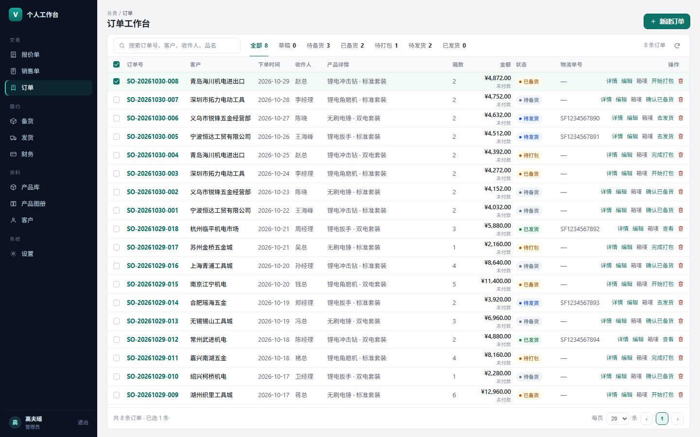
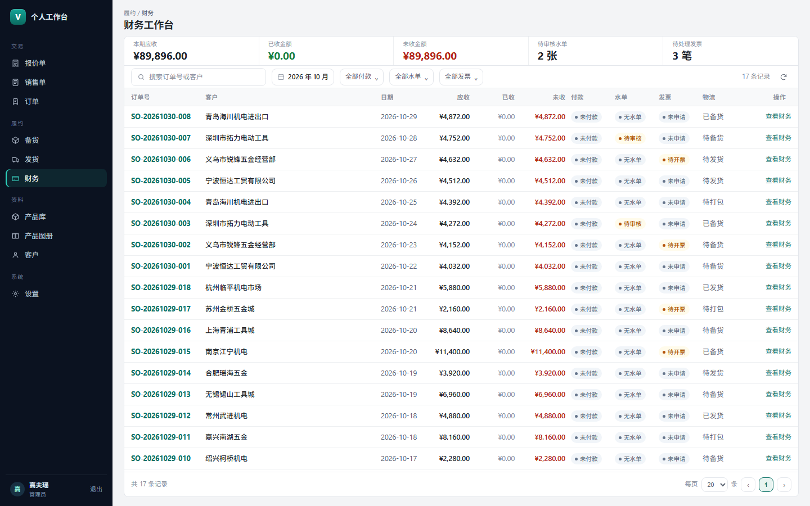
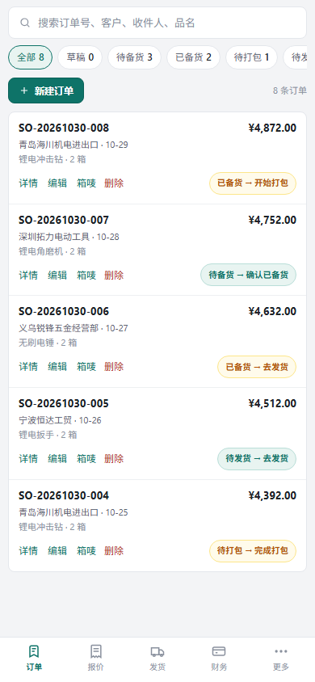

# 整体 UI 改造需求 — 从「卡片堆叠」到「ERP 工作台」

> 状态：**v1.5（B 方案；阶段 1–4 已全部上线）**
> 日期：2026-10-31
> 范围：桌面端 + 手机端 + 全部 10 个模块 + 页面外壳 + 弹窗/抽屉/表格
> 约束：**只改界面与样式，不改业务流程、字段、接口和数据库；所有现有操作必须保留。**

一句话目标：**一个页面只有一个工作面，用分隔线和排版分层，不再用一张张卡片把内容一层层垫起来。**

---

## 一、现状诊断（有测量数据）

本轮已按 1440×900 桌面和 390×844 手机实测现有页面。现状截图见 `docs/ui-redesign/current-*.png`（使用 e2e 隔离库，不含线上客户数据）。

### 1.1 主要问题

| 页面 | 现状结构 | 实测问题 |
| --- | --- | --- |
| 订单 | 标题 → **7 张状态卡** → 大面板 → 工具条 → 表格 | 状态卡占 63px + 12px 间距；首条数据到 **266px**；行高 **58px**，900 高屏幕只看到 8 行 |
| 财务 | 工具条 → **5 张统计卡（两行）** → 面板 → 表格 | 统计区 **180px**；首条数据到 **329px**；900 高屏幕只看到 8 行 |
| 发货 | 页面 → 大面板 → 左卡 + 右卡 → 订单小卡/批次卡 | 同页 **9 个卡片面**，三层嵌套；左右两栏各自再套小卡 |
| 产品库（大图） | 大面板 → 20px 内边距 → 产品卡 | 产品卡高 **283px**；6 列；面板里再套卡片，外面还有一层圆角边框 |
| 客户 | 左卡（客户列表）+ 右卡（客户产品） | 两张大卡并排，右卡里还有工具条和表格；手机端左卡直接隐藏，改为抽屉 |
| 设置 | 左卡（菜单）+ 右卡（表单） | 两层大卡；右卡里再用浅色块和边框分组，像「卡里放卡」 |
| 手机订单 | 搜索 → 状态胶囊两行 → 新建按钮 → 订单大卡 | 首张卡到 **234px**；单卡高 **273px**，一屏只能看 2 张；字段名和值重复占行 |
| 手机财务 | 搜索 → 月份/筛选两行 → 5 张统计卡 → 财务卡 | 首条记录到 **353px**；统计卡占 **133px**；单卡 221px |

### 1.2 样式层的技术债

- 卡片圆角 16px、控件圆角 10px、弹窗 20px，同屏出现多种圆角；全站硬编码 **12 种圆角**。
- 全站 **73 处 box-shadow**，页面、卡片、按钮、浮层都在浮起，层级失去意义。
- 全站 **106 处十六进制颜色（约 50 种色）**、84 处 rgba，颜色语义不统一。
- `.page-shell`、`.table-panel`、`.section-box`、`.modal-body`、`.status-cards` 等选择器在 `app.css` 里被重复定义，后写的覆盖先写的。
- 内联 style 密集：订单详情 103 处、订单表单 65 处、设置页 43 处、订单页 30 处。改一处颜色要翻多个文件。
- 断点不统一：令牌写了 1180/900/640，实际媒体查询里还有 1000、860，共 42 段。

### 1.3 现有优点（不要改掉）

- 深色侧栏 + 深青主色有辨识度，保留。
- 手机端「状态胶囊一键推进下一步」是很好的业务设计，保留并压缩。
- 订单、产品、图册的图片浏览与批量操作逻辑完整，不改流程。
- 手机端底部 Tab、悬浮搜索、返回键关闭浮层等已有交互，继续沿用。

---

## 二、目标与边界

### 做

1. 把「卡片作为布局容器」改成「平面工作台 + 一条状态带 + 一张主表」。
2. 压缩首屏无效高度，让数据更早出现、同屏看到更多行。
3. 统一颜色、字号、圆角、阴影、间距、表格密度、弹窗尺寸。
4. 桌面端做出 ERP 的「列表页 + 对象页」结构；手机端做紧凑列表行，不再是大卡片。
5. 清理重复 CSS 与硬编码，建立可复用的页面骨架组件。
6. 保持深色模式、现有品牌色、全部操作入口。

### 不做

- 不改任何业务逻辑、字段、权限、接口、数据库、打印/导出/PDF 逻辑。
- 不删功能、不合并模块、不调整菜单顺序（只加分组标题）。
- 不引入 Ant Design、Element、MUI 等组件库；继续用现有 React + 自研 CSS，避免整站重写与包体膨胀。
- 不为了「像 ERP」而做复杂菜单树、顶部多级导航、重色表格。
- 不把桌面表格强行搬到手机；手机仍用适合触摸的列表。

---

## 三、参考风格与取舍

参考对象不是照抄皮肤，而是借结构：

| 参考 | 借鉴 | 不借鉴 |
| --- | --- | --- |
| SAP Fiori（List Report / Object Page） | 一个内容区、筛选条、吸顶表头、详情页用锚点分区；对象信息按「概览 → 明细 → 附件」组织 | 顶部 Shell Bar、企业蓝、复杂 Fiori 控件 |
| Dynamics 365 Business Central | Role Center 的指标带、列表 + 右侧 FactBox、紧凑工具栏 | Ribbon 大按钮、密集的功能区标签 |
| Odoo | 左侧应用栏、面包屑 + 状态条、列表内联搜索、表单分区 | 紫色主题、Chatter、圆润的消费级观感 |
| 金蝶 / 用友 | 高密度表格、固定操作列、数字等宽对齐 | 复杂树形菜单、老式灰蓝配色 |

**结论：SAP 的骨架 + Business Central 的指标带 + Odoo 的亲和力 + 现有深青品牌。**
视觉上更像「专业工具」，而不是「SaaS 营销页」。

### 目标样张（可点开看原图）

- [订单工作台 · 桌面 1440×900](docs/ui-redesign/target-orders-desktop.png)
- [财务工作台 · 桌面 1440×900](docs/ui-redesign/target-finance-desktop.png)
- [发货工作区 · 桌面 1440×900](docs/ui-redesign/target-shipping-desktop.png)
- [订单 · 手机 390×844](docs/ui-redesign/target-orders-mobile.png)

样张源文件：[docs/ui-redesign/target-mockup.html](docs/ui-redesign/target-mockup.html)（静态 HTML，只用于确认风格，不是生产代码）。







### 阶段 1 实施记录（已上线，636f0b6）

- [订单 · 桌面](docs/ui-redesign/phase1-orders-desktop.png)
- [财务 · 桌面](docs/ui-redesign/phase1-finance-desktop.png)
- [产品库大图 · 桌面](docs/ui-redesign/phase1-products-gallery-desktop.png)
- [订单详情抽屉](docs/ui-redesign/phase1-order-detail.png)
- [产品详情抽屉](docs/ui-redesign/phase1-product-detail.png)
- [产品编辑弹窗（圆角 8px）](docs/ui-redesign/phase1-product-editor.png)
- [设置页（圆角 8px）](docs/ui-redesign/phase1-settings.png)
- [订单 · 手机](docs/ui-redesign/phase1-orders-mobile.png)
- [财务 · 手机](docs/ui-redesign/phase1-finance-mobile.png)
- [订单 · 平板 1024](docs/ui-redesign/phase1-orders-tablet.png)
- [财务 · 平板 1024](docs/ui-redesign/phase1-finance-tablet.png)

实测（本机测试环境，顶部多 26px 测试横条；生产无横条，首条数据再减 26px）：

| 指标 | 改造前 | 阶段 1 实测 |
| --- | --- | --- |
| 订单桌面首条数据 | 266px | **166px**（生产约 140px） |
| 财务桌面首条数据 | 329px | **210px**（生产约 184px） |
| 订单行高 | 58px | **38px** |
| 手机订单首条 | 234px | **200px**（生产约 174px） |
| 手机订单单条高度 | 273px | **138px** |
| 手机财务首条 | 353px | **250px**（生产约 224px） |
| 手机财务单卡 | 221px | **153px** |
| 产品图库（1440） | 6 列 / 卡 283px / 图 137px | **6 列 / 卡 263px / 图 171px 方形** |
| 产品列表行高 | 约 120px（供应商竖排） | **56px，供应商单行省略** |
| 平板 1024 页面横向溢出 | — | **0**（次要列收起，金额/状态/操作保留） |

说明：本阶段仅改订单、财务、产品库及其详情抽屉 + 通用弹窗外壳；备货/发货/客户/单据/设置仍沿用旧样式，按阶段 2–3 继续。按用户反馈，产品库大图恢复 1:1 方形并保持 6 列（图约 171px，接近原图观感）；全站核心圆角（卡片、输入框、按钮、弹窗）已统一为 **8px**，只保留胶囊 999、圆形 50%、贴边 0。全量验证：类型检查通过、单测 617 通过、相关 e2e 29 通过；全量 e2e 139 通过，2 个并发用例单独复跑通过，1 个既有用例仍按旧版「颜色/插脚两字段」断言（当前代码已有三字段），与本轮 UI 改造无关。


### 阶段 2 实施记录（已上线，b0d332e）

- [备货 · 桌面](docs/ui-redesign/phase2-stock-desktop.png)
- [发货 · 桌面](docs/ui-redesign/phase2-shipping-desktop.png)
- [客户产品库 · 桌面](docs/ui-redesign/phase2-customer-desktop.png)
- [备货 · 手机](docs/ui-redesign/phase2-stock-mobile.png)
- [发货队列 · 手机](docs/ui-redesign/phase2-shipping-queue-mobile.png)
- [当前批次 · 手机](docs/ui-redesign/phase2-shipping-batch-mobile.png)
- [客户产品 · 手机](docs/ui-redesign/phase2-customer-mobile.png)
- [客户选择 · 手机](docs/ui-redesign/phase2-customer-drawer-mobile.png)
- [发货 · 平板 1024](docs/ui-redesign/phase2-shipping-tablet.png)
- [客户产品库 · 平板 1024](docs/ui-redesign/phase2-customer-tablet.png)

实测（测试环境含 26px 横条）：

| 指标 | 阶段 2 实测 |
| --- | --- |
| 备货统计区 | 4 张卡合并为 **53px 指标带** |
| 备货首个供应商分组 | 顶部 216px，行高 **39px**，所有分组在同一面板 |
| 发货卡片面 | **1 个左右分栏工作面**，左 360px / 右自适应 |
| 发货首个未发货订单 | 行高 **71px**，无横向溢出 |
| 客户产品工作面 | 左右一张面：左 **260px** / 右自适应 |
| 客户产品行高 | **44px** |
| 客户产品手机卡 | 单卡 **220px**，2 列字段，无横向溢出 |
| 平板 1024 | 页面无横向溢出；客户表保留状态/品名/客户 SKU/最终价格/操作 |

说明：阶段 2 只改备货、发货、客户产品库及其移动端；报价/销售单/设置仍在阶段 3。备货组仍保留 `.stock-group` 钩子，发货仍保留 `.shipping-available-order` / 跟踪单号输入，客户产品仍保留成本价显隐，原有功能不变。相关 e2e 10 项通过。


### 阶段 3 实施记录（已上线，3f07b43）

- [报价单 · 桌面](docs/ui-redesign/phase3-quotations-desktop.png)
- [销售单 · 桌面](docs/ui-redesign/phase3-sales-desktop.png)
- [产品图册 · 桌面](docs/ui-redesign/phase3-catalog-desktop.png)
- [供应商图册 · 桌面](docs/ui-redesign/phase3-catalog-supplier-desktop.png)
- [设置 · 桌面](docs/ui-redesign/phase3-settings-desktop.png)
- [报价单 · 手机](docs/ui-redesign/phase3-quotations-mobile.png)
- [销售单 · 手机](docs/ui-redesign/phase3-sales-mobile.png)
- [产品图册 · 手机](docs/ui-redesign/phase3-catalog-mobile.png)
- [设置 · 手机](docs/ui-redesign/phase3-settings-mobile.png)

说明：阶段 3 完成报价单、销售单、产品图册、设置四个模块：

- 报价/销售：页头统一（面包屑 + 标题 + 说明），列表行高 38px，表头吸顶，金额右对齐；手机卡片压缩到 160–180px，状态选择收窄，操作按钮保持可见。
- 产品图册：我的图册改为扁平行（名称/状态/产品数/毛利率/链接/打开次数 + 操作），供应商图册保持两列文件卡（长文件名截断，按钮不出卡）；选品编辑沿用一张工作面。
- 设置：左侧导航改为无卡片导航栏（200px），右侧一整张内容面，每个分区用标题 + 分隔线，不再一张分区一张卡；手机菜单为胶囊一行行铺开，页面无横向滚动。
- 相关 e2e 24 项通过（报价、销售、图册、供应商图册、设置预设、颜色插脚、手机布局）。


### 阶段 4 实施记录（已上线，c9adb28）

- [订单编辑 · 桌面](docs/ui-redesign/phase4-order-form-desktop.png)
- [订单编辑 · 手机（全屏）](docs/ui-redesign/phase4-order-form-mobile.png)
- [报价编辑 · 桌面](docs/ui-redesign/phase4-quote-form-desktop.png)
- [销售编辑 · 桌面](docs/ui-redesign/phase4-sales-form-desktop.png)
- [销售编辑 · 手机](docs/ui-redesign/phase4-sales-form-mobile.png)
- [箱唛编辑 · 桌面](docs/ui-redesign/phase4-label-editor-desktop.png)
- [箱唛编辑 · 手机](docs/ui-redesign/phase4-label-editor-mobile.png)
- [订单详情 · 手机](docs/ui-redesign/phase4-order-detail-mobile.png)
- [售价计算 · 手机](docs/ui-redesign/phase4-price-calculator-mobile.png)
- [确认框 · 手机（居中卡片）](docs/ui-redesign/phase4-confirm-mobile.png)
- [打印预览 · 手机](docs/ui-redesign/phase4-print-mobile.png)
- [设置底部操作条 · 手机](docs/ui-redesign/phase4-settings-bottom-mobile.png)
- [产品图册 · 手机（恢复新建入口）](docs/ui-redesign/phase4-catalog-mobile.png)
- 深色模式：[订单编辑](docs/ui-redesign/phase4-dark-order-form.png)、[报价编辑](docs/ui-redesign/phase4-dark-quote-form.png)、[销售编辑](docs/ui-redesign/phase4-dark-sales-form-desktop.png)、[客户产品编辑](docs/ui-redesign/phase4-dark-customer-product.png)

说明：阶段 4 统一了弹窗/抽屉与表单外壳，并把深色模式补齐到所有编辑弹窗：

- **弹窗尺寸**：复杂编辑改为订单/产品 1040px、报价/销售 1200px；手机端表单和详情全屏（390 宽实测 390×818，圆角 0），只有确认框/小设置框保持居中卡片（358 宽，圆角 8px）。头部 48px、底部操作条 56px，底部避让安全区。
- **表单内部去卡片**：报价/销售的分区改为「标题 + 1px 分隔线」，订单/销售底部保存条吸底；「编辑产品明细」等按钮统一为次级按钮，不再出现浏览器默认灰底。
- **手机专项**：订单详情摘要 6 列改 2 列，财务摘要 4 列改 2 列；箱唛编辑器三栏在手机改为「横向箱唛列表 + 缩放预览 + 字段」，打印预览工具栏两行；设置、图册、发货页补足底部导航让位；图册页恢复「新建图册」入口。
- **深色模式**：`color-scheme` 随主题切换；TSX 内 426 处硬编码颜色改为令牌，CSS 中旧的状态色/边框色/白底同步换令牌；原生日期、下拉、滚动条不再白底白字。
- **顺带修掉的竞态**：打开财务详情时若客户列表尚未加载完，开票抬头/税号会留空；现在按订单上的客户 ID 补拉一次客户资料再带入，弱网/刚开页时不再空着。
- **回归**：类型检查、构建通过；单测 **617** 通过；全量 e2e **142** 通过（单 worker 串行跑；并行模式下「体积参数」旧用例会和其他计算器用例共享全局参数而互扰，单独复跑通过）。1440/1024/390 三档、深色模式下 10 个页面横向溢出均为 **0**。原先按「颜色/插脚两字段」断言的旧用例已同步为当前三字段（颜色/插脚/电压）。

### 上线后修正（2026-10-31）

- **手机端产品详情**：阶段 4 把详情网格强制成两列，导致「采购报价 / 包装信息 / 图片」这类跨列内容被塞进半格；现已改回手机单列，所有字段占满整行，底部四个操作按钮改为两列排布。报价行不再重复显示供应商名。[修正前](docs/ui-redesign/phase4-product-detail-mobile-before.png) / [修正后](docs/ui-redesign/phase4-product-detail-mobile.png) / [有图版本](docs/ui-redesign/phase4-product-detail-mobile-images.png)
- **订单详情**：不再显示「客户常用收件信息」，只保留客户名称、联系人、联系电话、收件人和收件信息；数据本身不动。
- **财务详情**：从订单详情进入财务详情时，底部增加「关闭」「返回订单」；点「返回订单」回到同一张订单并重新打开订单详情。[截图](docs/ui-redesign/phase4-finance-return-desktop.png)
- **产品保存**：保存成功后按钮一直停在「保存中」的根因是保存流程在等 IndexedDB 续传落盘；WebView 或多标签页把 indexedDB 卡住时它可能永远不回调。续传落盘改为后台进行，并给打开数据库/事务各加 1.5 / 2 秒上限；保存后的列表刷新最多等 1.5 秒。新增 e2e 模拟 IndexedDB 阻塞，验证保存仍能在 1.4 秒内结束。
- **订单首屏**：客户与收件人合并为「客户 / 收件人」一列，客户名在上、收件人在下；窄桌面隐藏列同步调整，表格少占一列。[桌面](docs/ui-redesign/phase4-orders-merged-desktop.png) / [平板](docs/ui-redesign/phase4-orders-merged-tablet.png) / [手机](docs/ui-redesign/phase4-orders-merged-mobile.png)
- **搜索候选词幕布**：输入框失焦后收起；延迟 120ms 是为了不打断点胶囊/删词，点在幕布内部不会误关。
- **供应商图册**：搜索条固定在面板顶部，卡片区独立滚动；修掉桌面/平板被整高网格拉伸造成的大块空白和满高卡片，手机保持单列紧凑卡片。[桌面](docs/ui-redesign/phase4-supplier-catalogs-desktop.png) / [平板](docs/ui-redesign/phase4-supplier-catalogs-tablet.png) / [手机](docs/ui-redesign/phase4-supplier-catalogs-mobile.png)
- **手机保存图片卡在「保存中」**：产品详情里挂着一个未打开的图片弹窗，会覆盖图库的原生保存回执，图片其实已进相册，按钮却一直等不到回执。现在只有图片弹窗真正打开时才注册回执；回归用例覆盖「先开产品详情再开图库保存」。
- **订单编辑收件人自动提取**：在「收件信息」里粘贴姓名、电话、地址后，自动提取收件人名称填入「收件人名称」；手动改过姓名后不再覆盖，清空姓名会恢复自动提取。选择客户时如果收件信息为空，也会从客户常用收件信息提取姓名。[桌面](docs/ui-redesign/phase4-order-recipient-autofill-desktop.png) / [手机](docs/ui-redesign/phase4-order-recipient-autofill-mobile.png)

---

## 四、设计原则

1. **一屏一工作面**：每个页面最多一层主面板；区块之间用 1px 分隔线、留白和标题分层，不再各自套卡片。
2. **数据优先**：首条数据尽量上移。桌面首条数据不超过 190px，手机不超过 200px。
3. **靠排版分层，不靠阴影**：字号、字重、颜色、对齐、线框决定层级；页面表面不投影。
4. **操作始终可见**：主操作在页头/工具栏，行操作在行尾，批量操作在选中后出现；不把高频动作藏进二级菜单。
5. **数字可扫**：金额右对齐、等宽数字、状态颜色一致、表头吸顶、首列吸附。
6. **手机做减法**：一个列表容器 + 分隔线行；单条 3 行内说完；触控目标不小于 36px。
7. **品牌只做点睛**：深青用于主按钮、选中态、链接、关键金额；大面积结构一律中性色。

---

## 五、设计令牌（统一源头）

改造后所有页面只使用以下令牌，不再写零散色值。深色模式同步给出对应值。

### 5.1 颜色

| 令牌 | 浅色 | 深色 | 用途 |
| --- | --- | --- | --- |
| `--color-page` | `#F3F4F6` | `#0E1116` | 页面底色 |
| `--color-surface` | `#FFFFFF` | `#171C24` | 主工作面 |
| `--color-surface-subtle` | `#F8F9FA` | `#1C222B` | 表头、只读区、悬停 |
| `--color-border` | `#E4E7EC` | `#2A3038` | 外框、控件边 |
| `--color-divider` | `#EEF0F2` | `#232932` | 表格行线、区块线 |
| `--color-text` | `#1F2329` | `#E6E9EF` | 正文 |
| `--color-text-secondary` | `#5B6472` | `#A3ADBD` | 次要文字 |
| `--color-text-muted` | `#8A919E` | `#71809A` | 标签、占位 |
| `--color-accent` | `#0E7368` | `#3EDBC9` | 主操作、选中、链接 |
| `--color-accent-soft` | `#E8F4F1` | `rgba(62,219,201,.12)` | 选中底、轻提示 |
| `--color-danger` | `#B42318` | `#F87171` | 删除、未收、异常 |
| `--color-warning` | `#B45309` | `#FBBF24` | 待处理、待打印 |
| `--color-success` | `#15803D` | `#4ADE80` | 已完成、已收 |

### 5.2 字号与字重

| 令牌 | 值 | 用途 |
| --- | --- | --- |
| `--text-2xs` | 11px | 标签、辅助说明、状态小字 |
| `--text-xs` | 12px | 表格正文、次要信息 |
| `--text-sm` | 13px | 控件、正文、手机正文 |
| `--text-md` | 14px | 区块标题 |
| `--text-lg` | 16px | 手机页标题 |
| `--text-xl` | 18px | 桌面页标题 |
| `--text-kpi` | 20px | 指标数字（仅指标带） |

数字统一 `font-variant-numeric: tabular-nums`。手机端正文保持 **13px**，不再单独放大。

### 5.3 间距、圆角、阴影、控件

| 项 | 现状 | 改造后 |
| --- | --- | --- |
| 页面内边距（桌面） | 20 / 24 | **16 / 20** |
| 页面内边距（手机） | 10 | 10（保留贴边） |
| 页面纵向间距 | 16 | **10–12** |
| 控件圆角 | 10 | **8** |
| 工作面/面板圆角 | 16 | **8** |
| 弹窗圆角 | 20 | **8**（手机 0） |
| 页面表面阴影 | 双层投影 | **无** |
| 浮层/弹窗阴影 | 三种 | 只保留 **2 级**：浮层、弹窗 |
| 控件高度 | 34–38 | **32**（手机 34） |
| 表格行高 | 34–58 | **38**（紧凑 34） |
| 表头高度 | 29–36 | **32** |
| 工具栏高度 | 38–60 | **40** |

### 5.4 断点

统一为 **1200 / 900 / 640** 三档，删除 1000、860 等零散断点。侧栏 200px（现 208），收起 64px。

---

## 六、全局框架

### 6.1 桌面端（不新增顶部大横条）

现有顶栏没有全局导航条，这是优点，不额外加一条 44px 的 Shell Bar 去占高度。页面结构：

```
┌ 侧栏 200 ┬────────────────────────────────────────────────────┐
│ 品牌       │ 业务 / 订单                                      │ ← 面包屑 11px
│            │ 订单工作台                          [ + 新建订单 ] │ ← 页头 44px
│ 交易       │ [搜索………………] [全部 8][待备货 3][待发货 2]  8 条 │ ← 工具栏 40px
│  报价单    │ ┌────────────────────────────────────────────────┐ │
│  销售单    │ │ 表头 32                                        │ │
│  订单      │ │ 行 38 × 14~16                                  │ │
│ 履约       │ │ …                                              │ │
│  备货      │ └────────────────────────────────────────────────┘ │
│  发货      │ 共 8 条 · 每页 20 · 第 1/1 页          [分页 44] │
│  财务      │                                                  │
│ 资料       │                                                  │
│  产品库    │                                                  │
│  产品图册  │                                                  │
│  客户      │                                                  │
│ 系统       │                                                  │
│  设置      │                                                  │
│ 用户/退出  │                                                  │
└────────────┴──────────────────────────────────────────────────┘
```

规则：

- 侧栏按「交易 / 履约 / 资料 / 系统」加分组小标题；导航项 34px 高，选中态用左侧 3px 深青条 + 淡底，去掉渐变光晕与右侧箭头。
- 页头只保留「面包屑 + 标题 + 右侧主操作」，不放大标题，不占一整张卡。
- 主工作面是一张白面：1px 边框、8px 圆角、无阴影。工具栏、表头、分页都在这一张面内。
- 一个页面只有一个滚动容器；表格内滚动时表头吸顶，不要页面和面板各滚一次。
- 侧栏底部保留用户与「退出」，不新增顶部用户区。

### 6.2 手机端

```
[ 搜索 ……………………………………… ] 40
[全部 8] [待备货 3] [待发货 2] → 横向滚动
[+ 新建订单]                      8 条
┌──────────────────────────────────┐
│ SO-20261030-008      ¥4872 已备货 │
│ 青岛海川 · 10-29 · 赵总           │
│ 锂电冲击钻 · 2 箱                 │
│ 详情   编辑   箱唛         删除   │
└──────────────────────────────────┘
┌──────────────────────────────────┐
│ …                                │
└──────────────────────────────────┘
[订单] [报价] [发货] [财务] [更多] 56
```

- 首条记录不超过 200px；单条记录 120–150px；一屏至少 4–5 条。
- 一个白色列表容器 + 行分隔线，不再「每单一张浮起卡片」。
- 状态筛选横向滚动，首项「全部」固定；不换成两行胶囊。
- 底栏、悬浮搜索、下滑收起搜索保留。
- 表单/详情在手机上全屏，不做 94vh 的圆角大弹窗。

---

## 七、通用组件规范

### 7.1 页头 `PageHeader`

- 面包屑 11px 次要色，标题 18px/650（手机 16px），副标题 12px 次要色。
- 右侧主操作 32px 高；最多 1 个主按钮 + 1 个次按钮 + 1 个图标按钮。
- 页头高度 44px（手机 40px），不包卡片、不加背景。

### 7.2 工具栏 `Toolbar`

- 高度 40px，单行；搜索框 240–320px；筛选控件 32px；结果数右对齐。
- 批量操作条只在有选中项时出现，吸顶在表格上方，32px 高，不推走表格。
- 低频操作（导入导出等）放「更多」，但高频动作（新建、搜索、状态筛选、刷新）始终可见。

### 7.3 状态筛选带（替换订单页 7 张状态卡）

- 形态：分段标签，不是卡片；高度 32px，选中项 2px 深青下划线 + 深青文字 + 淡底。
- 内容：`全部 8 / 草稿 0 / 待备货 3 / 已备货 2 / 待打包 1 / 待发货 2 / 已发货 0`。
- 桌面放工具栏一行；宽度不够时状态标签单独一行，仍比 7 张卡省 30px 以上。
- 手机横向滚动，标签 30px 高，首项固定。
- 状态数量为 0 时仍显示标签，不隐藏（用户要知道这个阶段存在）。

### 7.4 指标带 `KpiStrip`（财务 / 备货）

- 一张白面、内部用竖分隔线切成 3–5 格；总高 **52px**，不再是一格一张卡。
- 每格：标签 11px + 数字 20px；金额右对齐或左对齐统一；不加大图标。
- 财务：本期应收 / 已收金额 / 未收金额 / 待审水单 / 待处理发票。
- 备货：待备货订单 / 供应商 / 产品项 / 合计数量。
- 手机：金额三格横向滑动，高度 44px；计数并入筛选行，不单独占一行。

### 7.5 表格 `DataTable`

- 字号 12.5–13px；表头 12px/600；行高 **38px**（紧凑 34）；单元格左右 12px。
- 表头吸顶；首列（订单号 / SKU / 销售单号）吸附；金额右对齐；状态列宽度固定。
- 只画横线，不画竖线；行悬停 `#F7F8FA`；选中行淡青底；斑马纹不做。
- 行操作：28px 图标或 12px 文字链，始终在行尾，不折叠进「⋯」；删除用红色图标并二次确认。
- 长文本单行截断 + tooltip；品名最多两行；数字不换行。
- 空状态：居中 120px 高，图标 20px + 12px 文案，不加虚线框。
- 窄桌面（901–1199px）：订单表隐藏收件人/产品摘要/箱数/物流，保留订单号、客户、日期、金额、状态、操作；财务表隐藏日期/已收/水单/发票/物流，保留订单号、客户、应收、未收、付款、操作。常见笔记本（1200–1419px）再多保留「产品摘要 / 日期」，仍藏起收件人、箱数、物流等次要列。订单号固定在左、操作固定在右，关键金额不因横向滚动被藏掉。

### 7.6 状态徽标

- 高度 20px、圆角 999、字号 11px；= 6px 圆点 + 文案 + 淡色底，不描边或只留极淡边。
- 订单、付款、水单、发票、单据状态全部共用一套语义色，不允许同一种状态在两张页面用两种颜色。
- 手机端状态胶囊可继续承担「下一步动作」，但高度不超过 30px，文案「当前状态 → 下一步」。

### 7.7 按钮与输入

- 主按钮：深青实底、白字、32px 高、8px 圆角、无渐变、无大阴影；悬停加深。
- 次按钮：白底 + 1px 边框；文字按钮 28px 高。
- 输入/下拉：32px 高、8px 圆角、1px 边框；聚焦 2px 淡青环。
- 图标按钮 28px，图标 14–16px；不常用图标加 tooltip。

### 7.8 区块与「卡片」的使用边界

- **禁止**用卡片包裹整个页面、整个表格、整块表单、左右分栏。
- **允许**卡片用于真正独立的内容单元：产品图册缩略图、图片卡、文件卡、日历/图表小部件。
- 页面内分组用：`区块标题（14px）+ 1px 分隔线 + 内容`；不再用浅灰底 + 圆角 + 内边距三层叠加。
- 任意页面从页面根往下，不允许出现「面板 > 卡片 > 卡片」三层带边框/圆角的容器。

---

## 八、逐页改造清单

### 8.1 订单工作台（P0）

现状：7 张状态卡 + 大面板；首条数据 266px；行高 58px。

改造：

1. 删除 `StatusCards` 组件在订单页的使用，改为工具栏内的**状态筛选标签**（带数量）。组件可保留给别处，但订单页不再渲染 7 张卡。
2. 页头：面包屑「业务 / 订单」+ 标题「订单工作台」+ 副标题；右侧「新建订单」。
3. 工具栏：搜索、状态标签、结果数；选中后出现批量操作条（一键备货 / 打包 / 发货 / 批量打印）。
4. 表格：订单号、客户、下单时间、收件人、产品详情、总箱数、金额（含付款状态）、状态（含箱唛状态）、物流单号、操作。行高 38；首列吸附；金额右对齐。
5. 行操作保留：详情 / 编辑 / 箱唛 / 业务下一步 / 删除；用 28px 图标 + 文字混排，不隐藏。
6. 订单详情改为右侧抽屉（760px），顶部摘要条 + 锚点导航（概览 / 产品明细 / 附件 / 财务 / 箱唛），各区块用分隔线，不再套浅色卡。
7. 手机：搜索 → 状态横向标签 → 「新建」与结果数一行 → 一个列表容器。单条 3 行：单号+金额/状态、客户+日期+收件人、产品摘要+箱数；操作行 32px。单条 ≤150px。
8. 目标：桌面首条数据 ≤190px；900 高屏幕 ≥14 行；手机首条 ≤200px，一屏 ≥4 条。

### 8.2 财务工作台（P0）

现状：5 张统计卡 180px；首条数据 329px。

改造：

1. 5 张统计卡合并成一条 **52px 指标带**（3 个金额 + 2 个计数），内部竖线分隔。
2. 工具条压成一行：月份切换 + 付款/水单/发票三个筛选 + 刷新；搜索框与月份同排。空间不够时筛选收进一个「筛选」按钮的幕布，但搜索和月份始终可见。
3. 表格行高 38；订单号首列吸附；金额右对齐；付款/水单/发票状态用统一小徽标；「查看财务」保持文字按钮。
4. 财务详情抽屉：顶部金额摘要（应收/已收/未收）+ 水单、发票、收款记录分区；内部不再用卡片。
5. 手机：指标带变横向滑动三格（44px）；计数并入筛选行；首条记录 ≤250px；单卡压到 150–180px。
6. 目标：桌面首条 ≤190px；900 高 ≥14 行。

### 8.3 备货工作台

现状：4 张统计卡 + 警示条 + 每个供应商一张面板。

改造：

1. 4 张统计卡合并成 52px 指标带。
2. 警示条压缩到 32px，直接贴在指标带下方；无警示时不占位。
3. 所有供应商分组放进**同一张主面板**：组头 34px（供应商名 + 订单数 + 合计），组间用 8px 灰带分隔，不再一组一张卡。
4. 产品行 38px；数量、备注、操作对齐；底部「标记已备货」固定在面板底部操作条。
5. 手机：指标带横向滑动；供应商组头吸顶；组内行 44px；批量勾选固定在组头。

### 8.4 发货工作台

现状：9 个卡片面，三层嵌套。

改造：

1. 整个页面只有**一张工作面**，中间 1px 竖分隔线分成左右两栏：左「未发货订单」360px，右「当前发货批次」自适应。
2. 左侧：搜索 + 订单行（单号、客户、收件人、状态、加入按钮），行高 56；不套小卡。
3. 右侧：批次头（单数/箱数）+ 摘要行（收件信息、物流、清空批次）、发货表、备注、底部「确认发货」操作条；不套小卡。
4. 已到「待发货」才可确认；其余订单可加入并保存物流单号，逻辑不变。
5. 手机：改为两步切换「未发货 / 当前批次」；底部固定确认条；不再左右并排。
6. 目标：卡片面从 9 个降到 **1 个**；桌面一屏看到 8 条以上未发货订单。

### 8.5 客户产品库

现状：左卡 + 右卡；手机端左卡隐藏改抽屉。

改造：

1. 一张工作面内做左右分栏：左侧客户列表 260px（搜索 + 客户行），右侧客户详情 + 产品表；中间 1px 分隔线，不再两张大卡。
2. 左侧客户行：名称、联系人/电话、产品数、待完善数；选中态左侧 3px 深青条。
3. 右侧头部：客户名 + 联系人 + 操作（编辑/停用/删除）；下方工具条（搜索/状态/添加客户产品）。
4. 产品表：状态、图片、品名、规格、客户 SKU、包装、装箱数、最近报价、最终价格、运费、备注。行高 40；图片 32；首列吸附。
5. 手机：客户列表作为一级页，点客户进入详情页（带返回），不再用隐藏抽屉；详情页工具条 + 产品列表行。
6. 编辑客户产品仍用抽屉 720px，内部表单分区不用卡片。

### 8.6 产品库

现状：大图面板内再套卡片；卡高 283px；6 列。

改造：

1. 去掉大图区域外层的面板内边距和边框，图库直接铺在页面上；滚动与分页仍由页面主面控制。
2. 图库卡改为「图 + 两行信息」的平铺块：1px 边框、8px 圆角、无阴影、无内层卡；图片 1:1，名称和 SKU 各一行，价格与操作在底部一行。
3. 1440 宽保持 6 列，间距 12px；图片恢复 1:1 方形并放大到约 171px（原约 137px），单块约 263px；一页仍 20 个，优先保证看图。
4. 列表视图：图片 36px、SKU 首列吸附、颜色/插脚用 20px 小胶囊、包装信息两行、供应商与价格列、操作列固定右侧；行高 56。
5. 产品详情改右侧抽屉 560px（大图 + 关键字段 + 操作）；「编辑产品」保留宽弹窗 1040px；图片管理保留全屏浮层。
6. 手机：列表/大图切换保留；大图 2 列，图片 1:1 约 165px、单卡约 259px；列表行 64px；搜索、筛选、敏感信息开关保持可见。
7. 目标：桌面图库 6 列、单页 20 个；列表一屏 ≥12 行；不再出现「面板套卡片」。

### 8.7 产品图册

现状：我的图册为空状态一张大面；供应商图册为卡中卡。

改造：

1. 我的图册：默认用列表（名称、产品数、毛利率、更新时间、链接/PDF 操作），行高 52；封面缩略图 36px。需要视觉浏览时切换为平铺封面墙（缩略图卡允许保留）。
2. 供应商图册：文件行列表（缩略图 40 + 文件名 + 供应商 + 时间 + 打开/下载），不再大卡套小卡；长文件名单行截断，按钮始终在行内。
3. 图册编辑页：左侧设置 300px（名称、毛利率、封面等）+ 右侧产品选择区；一张工作面，中间分隔线，不再左右各一张卡。
4. 产品选择网格每行 6–7 个，勾选圆钮固定右下，不压图片；批量操作固定顶部。
5. 手机：图册列表行 64px；编辑页上下分区；产品选择 2 列。

### 8.8 报价单 / 销售单

现状：桌面已是扁平列表，主要是密度和弹窗不统一。

改造：

1. 页头 + 单行工具条；状态筛选用 32px 标签，不再用大号胶囊；结果数与刷新靠右。
2. 表格行高 38；单号首列吸附；金额右对齐；状态徽标统一；操作列固定右侧。
3. 报价/销售单编辑保留宽弹窗（1040/1200），内部改为分区标题 + 分隔线；底部保存条固定，不随内容滚动。
4. 销售单金额区用「含税合计 / 已收 / 未付」三段紧凑摘要，不单独做 3 张卡。
5. 手机：列表行 3 行以内（单号+金额/状态、客户+日期、产品数/采购单号），操作行 32px；单条 ≤130px。
6. 报价转销售、复制、PDF、导出等操作不变。

### 8.9 设置

现状：左卡 + 右卡，右侧表单再用浅色块分区。

改造：

1. 左侧菜单改为**页面内的导航栏**：200px、无卡片边框、无阴影；分组标题 11px，菜单项 32px，选中左侧 3px 深青条 + 淡底。
2. 右侧内容是一张主工作面；每个设置分区用「标题 14px + 说明 12px + 分隔线 + 表单」，不再一张分区一张卡。
3. 表单两列（≥900px），标签在上、控件 32px；保存按钮固定在分区底部操作条；修改未保存时显示「未保存」。
4. 公司 Logo/二维码预览 80×80，操作按钮同行；账号列表行高 48；备份/恢复按钮同一行。
5. 手机：设置菜单作为一级列表，点分区进入详情页（带返回）；控件 34px、正文 13px；不再把所有分区堆成长卡片。
6. 所有现有设置项、危险操作二次确认、备份恢复流程不变。

### 8.10 登录 / 环境提示 / 全局提示

1. 登录卡改为 360px 宽、8px 圆角、1px 边框、无大阴影；输入 36px；主按钮 38px。
2. 测试环境横条保留，但高度 24px、字号 11px；不遮挡任何内容。
3. Toast 改为右上角紧凑提示（手机底部上方），最大宽度 360px；成功/错误图标 + 12px 文案，不堆叠超过 3 条。
4. 上传进度条、备份告警、续传提示改为 32px 高的工具条样式，紧贴页头下方，不遮挡表格。

---

## 九、弹窗、抽屉与表单

### 9.1 三种尺寸，不再随意定宽

| 类型 | 桌面 | 手机 | 用途 |
| --- | --- | --- | --- |
| 确认框 | 420px | 100% 宽 - 32px | 删除、停用、恢复等二次确认 |
| 详情抽屉 | 560 / 760px | 全屏 | 订单详情、产品详情、财务详情、客户产品 |
| 复杂编辑弹窗 | 1040px（订单/产品） / 1200px（报价/销售单） | 全屏 | 需要同时看多区块的表单 |

- 桌面弹窗圆角 8px、阴影只保留 1 级；手机全屏、无圆角、无阴影。
- 头部 48px、底部操作条 56px 固定；正文 16px 内边距，独立滚动。
- 弹窗内部**禁止再用卡片**；用「区块标题 + 分隔线」分区。
- 详情类优先抽屉，保留列表上下文；复杂编辑仍居中，避免侧边宽度不够。
- 订单详情使用锚点导航，不用 Tab 隐藏内容：概览 / 产品明细 / 附件与箱唛 / 财务 / 记录，滚动时高亮当前锚点。
- 关闭只能点按钮（保留现有防误触规则），不点遮罩关闭。

### 9.2 表单

- 标签在上，12px/500；控件 32px；说明 11px；错误 11px 红色，紧贴控件。
- 两列栅格 `repeat(2, minmax(0,1fr))`；长字段跨两列；手机单列。
- 金额、数量右对齐；单位固定在输入框右侧，不放进 placeholder。
- 必填标记统一红色 `*`；不重要的字段不隐藏，只做分组。

---

## 十、手机端专项

1. 字号基准 13px；标签 11px；表格/列表正文 13px；不因「更清楚」单独放大表单控件。
2. 触控目标最小 36×36；图标按钮 32×32 但热区 36。
3. 一屏信息密度：订单/财务/报价/销售/客户列表首条 ≤200px，单条 120–150px，至少 4 条可见。
4. 状态筛选横向滚动，不换行；筛选仍用现有「触发器 + 幕布 / 胶囊」，高度 ≤60vh，不改成全屏抽屉。
5. 列表容器统一：白底、8px 圆角、1px 边框、行间分隔线；不投影。
6. 长文本一律省略号 + 点击查看；操作按钮始终在行内，不因长名称被挤出。
7. 详情/编辑全屏；底部操作条固定，避让安全区；键盘弹起时当前输入不被遮挡。
8. 返回键：先关弹窗/幕布，再回上一级；现有 `navigation-history` 逻辑不变。
9. 深色模式同步适配；图片白底在深色下保持中性，不出现刺眼白块。

---

## 十一、样式与代码改造方式

1. **令牌先行**：先落 `tokens.css` 的新颜色/字号/圆角/阴影/尺寸；旧变量保留别名，避免一次性改爆。
2. **样式拆分**：
   - `tokens.css`：变量；
   - `base.css`：reset、字体、滚动条；
   - `components.css`：按钮、输入、表格、徽标、工具栏、弹窗、抽屉；
   - `pages.css`：页面专属布局。
   删除 `app.css` 中重复定义与后写覆盖的段落；单文件不再无限增长。
3. **页面骨架组件**：新增 `PageHeader`、`Toolbar`、`KpiStrip`、`StatusTabs`、`DataTable`、`Section`、`Drawer`、`EmptyState`、`FormGrid`；页面只组合，不重复写布局 CSS。
4. **不引入组件库**；继续用 `lucide-react` 图标与现有 React 结构。
5. **保留测试钩子**：现有 e2e 依赖 `.status-card`、`.table-panel`、`.orders-card-list` 等类名。改造时保留语义类名或同步更新测试，不能出现「测试全红」。
6. **深色模式**：新令牌必须有深色值；改完每个页面在浅色/深色各截一次图。
7. **可访问性**：正文对比度 ≥ 4.5:1；状态不只靠颜色，配圆点/文字；键盘 Tab 顺序正确；焦点环可见。
8. **性能**：不新增依赖；CSS 体积不增；图片仍走缩略图；表格不做全量重渲染优化之外的重构。

---

## 十二、实施阶段（每阶段可单独上线、可回滚）

| 阶段 | 内容 | 交付与验收 |
| --- | --- | --- |
| 0. 定稿 | 本文档 + 目标样张 + 令牌表 | 确认风格力度、密度、手机形态 |
| 1. 基础层 + 高频页 | 令牌、基础组件、页面骨架；订单、财务、产品库（含详情抽屉/编辑器） | 首条数据、行高、卡片层级达标；原有操作全在 |
| 2. 履约与客户 | 备货、发货、客户产品库（含手机钻取） | 发货降到 1 个工作面；客户页单面分栏 |
| 3. 单据与资料 | 报价单、销售单、产品图册、设置 | 列表/表单统一；设置无卡片 |
| 4. 统一收尾 | 弹窗/抽屉统一、手机端密度、深色模式、旧 CSS 清理、全量回归 | 全站视觉一致；e2e 与截图通过 |

每阶段流程：本地起实例 → 截图给用户确认 → 一次 commit/push/部署。**不做一次性大爆炸改版。**

### 风险与应对

| 风险 | 应对 |
| --- | --- |
| 旧页面尚未迁移，令牌改动导致串味 | 旧变量保留别名；按页迁移，未迁移页面不换结构，只换颜色/圆角 |
| 压密度后手机上误触 | 触控目标 ≥36px；先改间距和内边距，不先缩字号；真机检查 |
| 长品名/供应商名把按钮挤出 | 名称单行截断 + tooltip；操作列固定宽度，按钮不换行 |
| 深色模式漏改 | 令牌一次补齐；每页浅色/深色各截图；状态色对比度检查 |
| e2e 依赖旧类名 | 保留语义类名或同步改测试；每阶段跑全量 e2e |
| 样式拆分引发未知覆盖 | 先加新文件并逐步 import，旧 `app.css` 最后删除；每阶段可回滚 |
| 低性能设备滚动卡顿 | 不引入新依赖；表格固定高度、虚拟化暂不做；图片仍走缩略图 |

---

## 十三、验收标准

### 13.1 量化指标（1440×900 / 390×844）

| 指标 | 现状 | 目标 |
| --- | --- | --- |
| 订单桌面首条数据 | 266px | **≤190px** |
| 订单桌面可见行数 | 8 行 | **≥14 行** |
| 订单行高 | 58px | **38px** |
| 财务桌面首条数据 | 329px | **≤190px** |
| 财务统计区高度 | 180px | **52px** |
| 手机订单首条 | 234px | **≤200px** |
| 手机订单单条高度 | 273px | **≤150px** |
| 手机订单一屏条数 | 2 条 | **≥4 条** |
| 手机财务首条 | 353px | **≤250px** |
| 发货卡片面数量 | 9 个 | **1 个** |
| 产品图库图片 | 137px 方形 | **约 171px 方形，1440 保持 6 列** |
| 产品图库单块高度 | 283px | **约 263px**（优先图片尺寸） |
| 页面级横向滚动 | 部分表格允许 | **无**（只有表格内部滚动） |
| 表面阴影 | 73 处 | **页面表面 0 处** |
| 圆角 | 12 种混用 | **全站核心 8px**；胶囊 999、圆形 50%、贴边 0 保留 |
| 硬编码十六进制颜色 | 106 处 | **≤20 处**（其余走令牌） |

### 13.2 结构与视觉

- 任意页面从根向下，不出现「面板 > 卡片 > 卡片」三层带边框/圆角容器。
- 每个页面只有一个主工作面；图库缩略图、图片卡、文件卡除外。
- 表头吸顶、首列吸附、金额右对齐、状态色全站一致。
- 浅色/深色模式都通过截图检查；390 / 1024 / 1440 三档宽度无页面溢出。
- 空状态、加载中、错误、上传中、备份失败等状态都有对应样式，不留白块。

### 13.3 功能与数据

- 所有现有按钮、字段、筛选项、批量操作、打印、导出、PDF、上传、恢复流程可用。
- 不改接口、不改数据库、不迁移数据；改造前后同一份数据页面内容一致。
- 手机返回键、弹窗防误关、搜索历史、筛选记忆等行为不变。
- `npm run typecheck`、`npm run test`、`npm run test:e2e` 全绿；新增视觉回归截图。

---

## 十四、待拍板（请逐条回复）

| 编号 | 问题 | 建议 |
| --- | --- | --- |
| Q1 | 视觉力度选哪档？A 保守：只去卡片和阴影；B 标准 ERP：按本文档全面压密度；C 极密：行高 32、字号 12，接近传统 ERP | **B** |
| Q2 | 是否保留深色侧栏 + 深青品牌色？ | **保留**，只去掉渐变光晕和多余圆角 |
| Q3 | 订单页 7 张状态卡是否改为工具栏里的状态标签（数量仍在）？ | **改**，这是省空间最大的一刀 |
| Q4 | 手机端订单从大卡片改为「一个列表容器 + 紧凑行」是否接受？ | **改**，单条 273px → ≤150px |
| Q5 | 订单/产品/财务详情是否从居中弹窗改为右侧抽屉？复杂编辑仍用居中弹窗 | **改**，保留列表上下文 |
| Q6 | 是否接受分 4 个阶段上线，而不是一次全改？ | **分阶段**，每阶段可回滚 |
| Q7 | 是否新增全局顶栏（面包屑/全局搜索/通知）？ | **不加**，避免再占 44px；面包屑放页头 |

确认 Q1–Q7 后，先按阶段 1 在本地起实例出样张，再进入正式改造。
